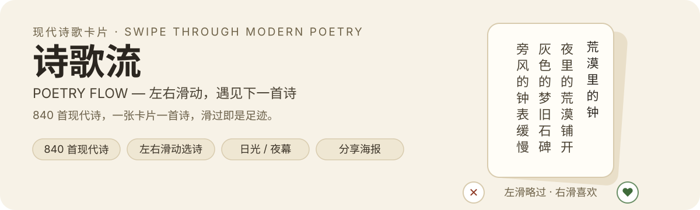

<p align="right"><a href="README.md">中文</a></p>

<p align="center">
  
</p>

<p align="center">
  <a href="https://poetry-flow.xiaosang.cc/">▶ Live Demo</a>
  ·
  <a href="https://github.com/holynova/poetry-flow">GitHub Repository</a>
</p>

Poetry Flow is a swipe-to-read web app for modern Chinese poetry: 840 poems, one per card. Swipe right to like, left to pass — every swipe becomes part of your reading trail. Two minimal themes (日光 Daylight / 夜幕 Night), mobile-first, portrait-friendly.

## Screenshot

<p align="center">
  
</p>

## Features

- **Swipe to read**: one poem per card — swipe right to like, left to pass; if you slip, undo within a few seconds.
- **840 modern poems**: the library is generated from JSON by `scripts/import-poems.mjs`; each poem has a title, author, lines, and tags.
- **Reading trail**: every swipe is recorded; the Stats page charts daily reads, and Favorites keeps the poems you liked.
- **日光 Daylight / 夜幕 Night**: two minimal palettes, one tap to switch; poem cards are set vertically in a serif face.
- **Share posters**: one tap renders a high-resolution poster image with a QR code and project link; `?poem=` links open a specific poem directly.
- **Never lose your place**: the deck lives in your local browser, so closing and reopening the page picks up where you left off.

## Run Locally

```bash
npm install
npm run dev        # Dev server
npm run build      # Production build
npm run preview    # Preview the build output
```

Import new poems (generate the library from `input/*.json`):

```bash
npm run import-poems
```

## Tech

- React 19 + TypeScript + Vite, Tailwind CSS 4; swipe animations with Framer Motion, icons with Lucide, stats charts with Recharts.
- Posters render with html-to-image, QR codes with qrcode; routing with React Router (Home / Favorites / Stats).

```
index.html                  Entry (Noto Serif SC + Plus Jakarta Sans)
src/App.tsx                 App shell and routing
src/pages/Home.tsx          Swipe-to-read home page
src/pages/Favorites.tsx    Favorites page
src/pages/Stats.tsx         Reading stats page
src/components/SwipeCard.tsx    Card swipe component
src/components/ShareModal.tsx   Share poster modal
src/hooks/useDeck.ts        Deck: shuffle, persistence, ?poem= deep links
src/hooks/usePoemStats.ts   Swipe records and daily stats
src/generated-poems.ts      Generated poem library (840 poems)
scripts/import-poems.mjs    Poem library import script
```
