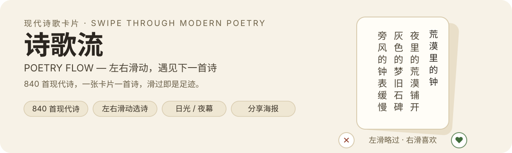

<p align="center">
  
</p>

<p align="center">
  <a href="https://poetry-flow.xiaosang.cc/">▶ 在线体验 Play Online</a>
  ·
  <a href="https://github.com/holynova/poetry-flow">GitHub 仓库</a>
</p>

诗歌流是一款用卡片滑动读现代诗的网页应用：840 首现代诗，一首一张卡；右滑喜欢、左滑略过，滑过的每一首都会记进你的情感足迹。日光与夜幕两种极简配色，移动端优先，竖屏可读。

Poetry Flow is a swipe-to-read web app for modern Chinese poetry: 840 poems, one per card. Swipe right to like, left to pass — every swipe becomes part of your reading trail. Two minimal themes (Daylight / Night), mobile-first, portrait-friendly.

## 截图 / Screenshots

<p align="center">
  
</p>

## 功能 / Features

- **滑动读诗**：一首诗一张卡片，右滑喜欢、左滑略过；手滑了可在几秒内撤销。
- **840 首现代诗**：诗库由脚本从 JSON 导入生成（`scripts/import-poems.mjs`），每首含标题、作者、诗行与标签。
- **情感足迹**：每次滑动都会记录；统计页用图表呈现每日阅读量，收藏页回看喜欢过的诗。
- **日光 / 夜幕**：两种极简配色，一键切换；诗卡竖排呈现，衬线字体。
- **分享海报**：一键生成带二维码与项目链接的高清海报图片；也支持 `?poem=` 链接直达指定诗。
- **进度不断**：牌堆存在本地浏览器里，关掉页面再打开，仍从上次的位置继续读。

## 本地运行 / Run Locally

```bash
npm install
npm run dev        # 开发服务器
npm run build      # 生产构建
npm run preview    # 预览构建产物
```

导入新诗（从 `input/*.json` 生成诗库）：

```bash
npm run import-poems
```

## 技术 / Tech

- React 19 + TypeScript + Vite，Tailwind CSS 4；滑动动画用 Framer Motion，图标用 Lucide，统计图表用 Recharts。
- 海报用 html-to-image 渲染、qrcode 生成二维码；路由用 React Router（首页 / 收藏 / 统计三页）。

```
index.html                  入口（Noto Serif SC + Plus Jakarta Sans）
src/App.tsx                 应用骨架与路由
src/pages/Home.tsx          滑动读诗主页
src/pages/Favorites.tsx    收藏页
src/pages/Stats.tsx         阅读统计页
src/components/SwipeCard.tsx    卡片滑动组件
src/components/ShareModal.tsx   分享海报弹窗
src/hooks/useDeck.ts        牌堆：洗牌、持久化、?poem= 直达
src/hooks/usePoemStats.ts   滑动记录与每日统计
src/generated-poems.ts      生成的诗库（840 首）
scripts/import-poems.mjs    诗库导入脚本
```

## English

**Poetry Flow** is a swipe-to-read web app for modern Chinese poetry: 840 poems, one per card. Swipe right to like, left to pass, and undo within a few seconds if you change your mind.

- **840 modern poems**: generated from JSON by `scripts/import-poems.mjs`; each poem has a title, author, lines, and tags.
- **Reading trail**: every swipe is recorded; the Stats page charts daily reads, and Favorites keeps the poems you liked.
- **Daylight / Night themes**: two minimal palettes, one tap to switch; poems are set vertically in a serif face.
- **Share posters**: one tap renders a high-resolution poster image with a QR code and project link; `?poem=` links open a specific poem directly.
- **Run it**: `npm install && npm run dev`. Build with `npm run build`.
- **Tech**: React 19 + TypeScript + Vite, Tailwind CSS 4, Framer Motion, Recharts, html-to-image, qrcode.
